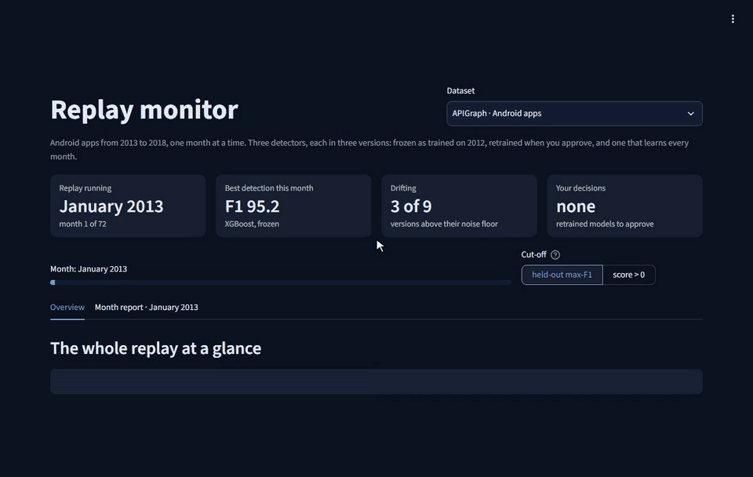
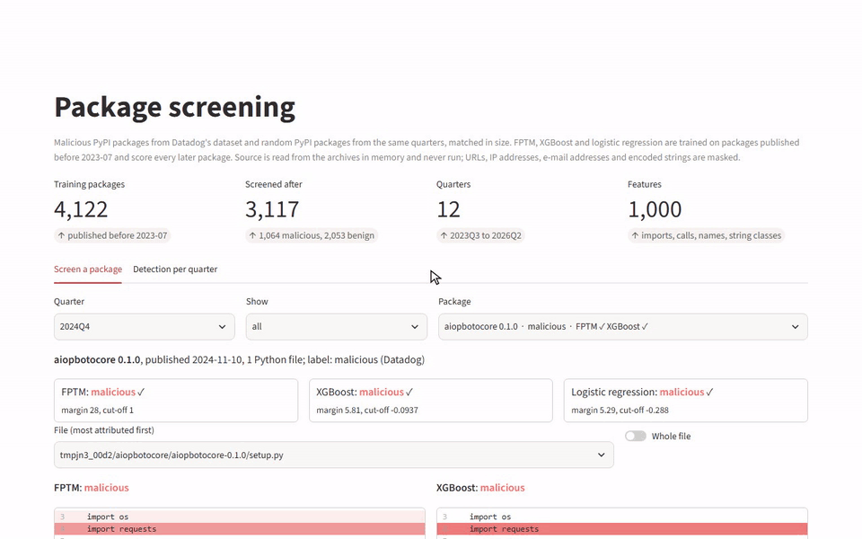
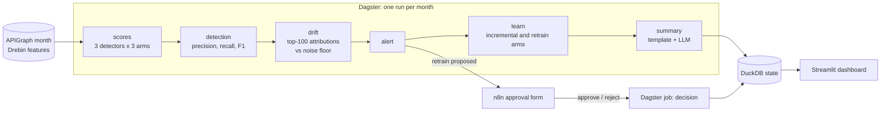

# tm-cyber-ops

A monitoring platform for malware detectors, built on two methods from
[tm-cyber-lab](https://github.com/Lukasz-G/tm-cyber-lab):

- exact Shapley attributions for Fuzzy-Pattern Tsetlin machines, computed in closed form;
- attribution drift that raises an alert only when it exceeds a noise floor, the distance expected
  between random samples of the same data.

Android malware data (APIGraph, 2012-2018) is replayed month by month. Three detectors (a Tsetlin
machine, XGBoost and logistic regression) score each month, are evaluated when the month's labels
arrive, and learn in three ways side by side. A dashboard shows the replay as it runs; retraining waits
for a human approval in n8n; language models write a short summary of each month.

A second page screens Python packages (Datadog's malicious PyPI packages against random PyPI packages)
and draws each detector's attributions over the code.

**Status:** work in progress. The APIGraph replay runs end to end; package screening has a first version
with frozen detectors. Four further datasets are planned.
The methods and their evidence are in tm-cyber-lab; every result here is a scoped demonstration
(dataset, period, size).



The dashboard in playback mode over the full APIGraph replay, January 2013 to December 2018. It shows F1 per detector and version at the max-F1 cut-off chosen on held-out 2012 apps,
the gain from updating, attribution drift against its noise floor, and the month report.

## Package screening: which lines made the call



Malicious packages from [Datadog's dataset](https://github.com/DataDog/malicious-software-packages-dataset)
and random PyPI packages published in the same quarters, matched in size
([dataset card](datasets/datadog/DATASET_CARD.md)). The three detectors learn from the tokens of each
package's Python files (modules imported, names and calls, classes of string literals) on the packages
published before July 2023, and score every later package. The page draws each detector's attributions
over the code: a line is red when its features push the package towards malicious, blue when they push
towards benign. FPTM attributions are exact (closed form); XGBoost uses interventional TreeSHAP; both
against the same 100 training packages, and each feature's attribution is split equally over its
occurrences. The source is read in memory from the published archives and never run; URLs, IP addresses,
e-mail addresses, names and encoded strings are masked before display.

The GIF shows aiopbotocore 0.1.0 (named like aiobotocore), whose install hook downloads a file and starts
it, then py-chromedriver-autoinstaller 1.0.0, a benign package that also calls PowerShell: that line is
red, the rest of the package is not, and all three detectors call it benign.

F1 of the malicious class per quarter of publication, at each detector's max-F1 cut-off chosen on 10% of
the training packages held out (frozen detectors, no retraining yet):

| period | malicious / benign | FPTM | XGBoost | logistic regression |
|---|---|---|---|---|
| held-out training packages (2022Q4-2023Q2) | 139 / 273 | 97.8 | 98.2 | 96.7 |
| 2023Q3 | 8 / 16 | 85.7 | 85.7 | 85.7 |
| 2023Q4 | 6 / 12 | 0.0 | 0.0 | 0.0 |
| 2024Q1 | 25 / 51 | 81.0 | 77.3 | 83.7 |
| 2024Q2 | 72 / 145 | 88.4 | 84.4 | 91.7 |
| 2024Q3 | 108 / 215 | 77.8 | 69.7 | 85.4 |
| 2024Q4 | 317 / 605 | 95.6 | 92.1 | 95.7 |
| 2025Q1 | 66 / 134 | 48.3 | 77.5 | 57.4 |
| 2025Q2 | 128 / 240 | 75.8 | 68.1 | 87.7 |
| 2025Q3 | 48 / 100 | 84.3 | 76.4 | 90.9 |
| 2025Q4 | 72 / 139 | 73.7 | 67.8 | 73.5 |
| 2026Q1 | 117 / 217 | 40.8 | 45.8 | 47.8 |
| 2026Q2 | 97 / 179 | 52.2 | 33.1 | 52.6 |

The frozen detectors decay as new campaigns appear; logistic regression has the highest F1 in 8 of 12 quarters. Most
packages were found by one rule set (GuardDog), so these numbers describe this set, not PyPI malware in
general (see the card's known biases).

## What one month does



| step | what it does |
|---|---|
| scores | applies pending approval decisions, then scores the month's rows with every detector and arm |
| detection | the labels arrive: precision, recall and F1 at the default rule (margin > 0) and at the max-F1 cut-off chosen on held-out training rows |
| drift | attributions of 500 rows of the month; the set of the 100 features with the largest mean absolute attribution is compared with the same set on held-out training rows (Jaccard distance). The noise floor is the 95th percentile of that distance between 1,200 random draws of held-out rows |
| alert | raised when the distance stays above its floor for two months, or when F1 falls 15 points below its held-out value |
| learn | the incremental arm learns the month; the retrain arm proposes a candidate while its alert is active |
| summary | a template text per detector and arm, and a summary of the month from each configured language model; every number in a model's draft must occur in the facts it was given |

## Detectors and learning arms

| | frozen | retrain | incremental |
|---|---|---|---|
| what happens after a month | nothing: the model trained on the 2012 pool | on an alert, a candidate is trained on the last 12 labelled months (with the 2012 pool while fewer exist) and proposed; it replaces the model once approved in n8n, or after a 5-minute timeout | the model learns the month's labelled rows |
| Tsetlin machine (FPTM) | | retrained from scratch | 5 more epochs from the saved automata |
| XGBoost | | retrained from scratch | 100 more boosting rounds |
| logistic regression | | retrained from scratch | refit with the L2 penalty centred on the previous weights |

The Tsetlin machine and XGBoost are trained on the same splits, with the same threshold rule and the
same noise-floor protocol, and both are reported. Attributions are exact for the Tsetlin machine
(closed form) and for logistic regression; XGBoost uses interventional TreeSHAP against a stated
background of 100 training rows.

## Running it

Requires [uv](https://docs.astral.sh/uv/), Julia 1.11, and Docker for n8n (optional).

```
uv sync
julia --project=julia -e "using Pkg; Pkg.instantiate()"
uv run tmco-up            # Dagster, the dashboard and n8n; continues a stopped replay
uv run tmco-up --reset    # starts a new replay
```

Package screening (set `GITHUB_TOKEN` for a fast download of Datadog's samples):

```
uv run python -m tmcyberops.datasets.datadog download   # malicious PyPI packages, pinned commit
uv run python -m tmcyberops.datasets.datadog benign     # matched random PyPI packages
uv run python -m tmcyberops.datasets.datadog prepare    # token features
uv run python -m tmcyberops.platform.screening build    # train, score per quarter, attributions
uv run streamlit run src/tmcyberops/platform/screening_page.py --server.port 8502
```

| service | address |
|---|---|
| dashboard | http://localhost:8501 |
| Dagster | http://localhost:3000 |
| n8n | http://localhost:5678 |

The APIGraph features are fetched and prepared by
`uv run python -m tmcyberops.datasets.apigraph download` and `... prepare` (see
[the dataset card](datasets/apigraph/DATASET_CARD.md)). Language-model summaries are optional: list the models in
`ops/platform.yaml` and put their keys in an untracked `.env`. The layer is provider-agnostic
(LangGraph with LiteLLM). Details: [docs/platform.md](docs/platform.md).

## Demonstrations

Each demonstration has a run script whose header states the question, scope, arms and pass criterion,
written before the run. Failures stay in the table. Full rows: [demos/INDEX.md](demos/INDEX.md).

| demonstration | question | verdict |
|---|---|---|
| [apigraph-repro](demos/apigraph-repro/) | do the detectors reproduce tm-cyber-lab's per-year F1 on APIGraph, and do the attributions sum to the margin? | PASS under an amended XGBoost tolerance; FAIL under the original |
| [apigraph-drift-floor](demos/apigraph-drift-floor/) | does month-to-month attribution drift of fixed models stay inside a same-month noise floor? | PASS |
| [apigraph-drift-reference](demos/apigraph-drift-reference/) | is the drift alarm calibrated at a fixed class mix, and how far does each month move from the training year? | FAIL: the control alerts at the expected rate for 5 of 12 models only |

## Datasets

Features only, with one exception: for the Datadog packages the Python source is read in memory from
the published encrypted archives, to compute token features and draw the attributions over the code; it
is never unpacked, installed or run. Each dataset is fetched from its publisher by a download script and
is never redistributed here. Each has a card in `datasets/<name>/DATASET_CARD.md`.

| dataset | task | status |
|---|---|---|
| APIGraph (Drebin features, Chen et al. 2023) | Android malware detection, 2012-2018 | on the platform |
| BODMAS | Windows PE malware detection, 2019-2020 | next |
| AnoShift (Kyoto-2006+) | network intrusion detection, 2006-2015 | planned |
| PhreshPhish | phishing web pages | planned |
| BETH | host process-event anomalies | planned |
| Datadog malicious software packages (PyPI), with a matched benign set | malicious package detection from source code, 2022-2026 | on the screening page |

## Roadmap

1. More datasets on the platform: BODMAS, then AnoShift; the learning arms (retrain, incremental) for
   package screening, and npm packages next to PyPI.
2. Agents with tools: alert triage, and a review of each retraining proposal before the approval form.
3. A comparison of language models (Claude, Kimi, Qwen) on the same month summaries.
4. The Tsetlin machine served to agents as an MCP tool.

## Implementation notes

The Tsetlin machine is `TMCore` from [tm-lab](https://github.com/Lukasz-G/tm-lab), pinned to a commit in
`julia/Project.toml`. Python writes binarised feature matrices in the `.tmx` format
([docs/matrix-format.md](docs/matrix-format.md)) and Julia reads them. Tests: `uv run pytest`.

## Licence

MIT. Dataset licences are given on each dataset card.
